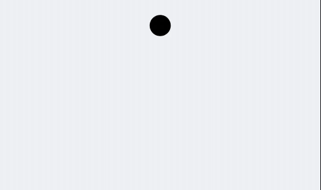
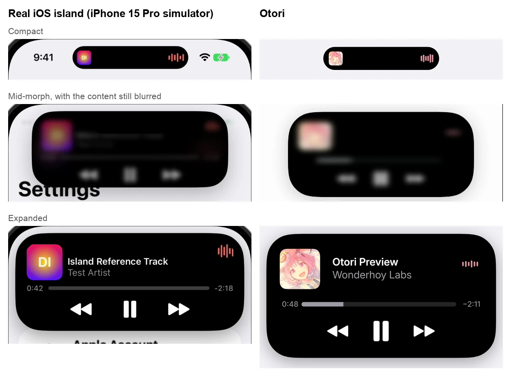

<p align="center">
  
</p>

<h1 align="center">Otori</h1>

<p align="center">A Dynamic Island for your Pixel.</p>

<p align="center">
  <a href="https://github.com/wonderhoy-labs/otori/actions/workflows/build.yml"></a>
  <a href="LICENSE"></a>
</p>

<p align="center"><sub>A <a href="https://github.com/wonderhoy-labs">Wonderhoy Labs</a> project</sub></p>

The Dynamic Island is one of the things you miss after moving from an iPhone to Android. Otori brings it to the Pixel.

Play some music and a black pill grows out of the camera, with the album art and a moving waveform. Long press it for
the full player. When nothing's playing, it shrinks back into the camera hole and your phone looks the way it always did.

It doesn't need root. It also doesn't have Android's internet permission, so it has no way to send anything anywhere.

<p align="center">
  
</p>

> **This is early.** We've only tested it on one Pixel 10 Pro running Android 17, and it only does music so far. Other
> phones with a camera hole at the top centre should work, but we haven't tried any. If you try one, please
> [open an issue](https://github.com/wonderhoy-labs/otori/issues) and tell us how it went, even if it just worked.

## What you need

- Android 13 or newer.
- A camera hole at the top centre of the screen. Otori still runs without one, but it won't have a camera to hide in.
- A music app that shows playback controls in your notifications. Apple Music is the one we've tested, and Spotify and
  YouTube Music use the same part of Android.

## Install

Download the APK from [Releases](https://github.com/wonderhoy-labs/otori/releases) and open it on your phone, or install
it with `adb`:

```bash
adb install -r otori-v0.1.0.apk
```

You can also [build it yourself](#development).

Open Otori and tap **Turn On** on both cards. Each one takes you to the right place in Settings:

- **Show the island:** tap Otori, turn on **Use Otori**, then tap **Allow**.
- **See what's playing:** turn on the switch, then tap **Allow**.

Android's warnings about these sound alarming. [Here's what Otori actually does with them.](#privacy)

**Is a switch greyed out?** Android blocks these switches for apps installed from outside an app store, until you allow
it. Go to Settings > Apps > Otori, tap the ⋮ menu, choose **Allow restricted settings**, then try again.

Want to see it first? **Try the Preview** in the app runs the island with a pretend player, and needs no permissions.

## Use it

Play some music, then leave your music app. The island only shows up while that app isn't on screen.

| | Tap | Long press | Swipe |
| --- | --- | --- | --- |
| **Music island** | Opens your music app | Opens the player | Down opens the player. Sideways tucks it away. |
| **Player** | Art or title opens your music app. Tap outside to close. | | Up closes it |
| **Tucked away** | | | Sideways, starting at the camera, brings it back |

You can drag the progress bar to move around in a song. The player closes by itself after 12 seconds if you leave it
alone. After you pause, the island stays for 20 seconds and then goes away. It stays hidden on the lock screen.

When nothing's playing, the island takes no touches at all, so pulling down the status bar works as usual, even right
over the camera.

## How close is it to the real thing?

Close. We ran the real island on an iPhone 15 Pro simulator, tracked its outline through every frame, and built Otori
from those numbers. Then we measured Otori with the same tool:

| Animation | Average difference in width | On screen, about |
| --- | --- | --- |
| Expanding | 0.74 pt | 0.1 mm |
| Collapsing | 1.75 pt | 0.3 mm |

<p align="center">
  
</p>

The simulator can't show the real music player, so the expanded iOS shot is a test layout inside the real island. Otori's
player layout was matched to screenshots from a real iPhone instead.

Some things are different on purpose:

- **When idle,** an iPhone shows a black pill because it has sensors to hide. A Pixel only has a camera hole, so Otori
  shrinks into it.
- **Otori gets narrower** when your status bar is full, so it doesn't cover your icons. It always stays centred on the
  camera, and stops shrinking at about 99 pt, the least that fits the art, the camera and the waveform.

## How it works

Otori is made of two parts, each using one of the permissions you turned on:

```
                           Otori APK
                               │
              ┌────────────────┴─────────────────┐
     Accessibility service             Notification listener
              │                                  │
      ┌───────┴────────┐                  media sessions
  overlay windows   status bar                   │
      │             icon positions       song, art, controls
  the island
```

An accessibility overlay is the only kind of window an ordinary app can draw above the status bar. There are two of them.
A large one draws the island and takes no touches. A small invisible one sits exactly where the island is and catches
touches for it, so touches anywhere else go straight to your apps.

The motion comes from physics rather than a fixed animation. Each size has a spring, using settings fitted to the real
island, so interrupting an animation stays smooth. The drawing is all custom, and the app has no third-party libraries.

## Privacy

Worth reading, because you're giving this app a lot of trust. Android's warnings describe everything these permissions
*could* allow, and they could allow a lot.

| Permission | Why Otori needs it | What it reads |
| --- | --- | --- |
| **Accessibility** | It's the only way to draw above the status bar and around the camera. | Which app is in front, and where the status bar's icons are. Not the content of your apps. |
| **Notification access** | Android only lets apps see what's playing if they have this. | The current song, art and playback controls. It ignores what your notifications say. |

**Otori can't go online.** It doesn't have the internet permission, and has no analytics or third-party code. You can
check with:

```bash
adb shell dumpsys package com.wonderhoylabs.otori | grep -A3 "requested permissions"
```

The code that uses these is short, so you can read it yourself:
[`StatusBarProbe.kt`](app/src/main/java/com/wonderhoylabs/otori/StatusBarProbe.kt),
[`MediaSource.kt`](app/src/main/java/com/wonderhoylabs/otori/MediaSource.kt) and the `onAccessibilityEvent` function in
[`IslandService.kt`](app/src/main/java/com/wonderhoylabs/otori/IslandService.kt).

## Troubleshooting

**A switch is greyed out in Settings.** See [Install](#install). You need **Allow restricted settings** first.

**The island doesn't appear.** Check that both cards in the app say **On**. If you've used **Force stop** on Otori,
Android won't restart it by itself, so turn **Use Otori** off and on again.

**Music is playing but there's no island.** It stays hidden while your music app is on screen, and on the lock screen.
If neither applies, check whether your music app shows playback controls in the notification shade. If it doesn't, Otori
can't see it either.

**The island disappeared when I swiped it.** A sideways swipe tucks it away until the next song. Swipe sideways again,
starting at the camera, to bring it back.

**The island covers one of my icons.** It only does this at its minimum width, when the status bar is very full.

**Swiping down on the island opens the player, not my notifications.** That's on purpose. Swipe anywhere else along the
top of the screen for notifications.

## Known issues

- It only does music. Calls, timers and charging aren't in yet.
- There are no favourite or AirPlay buttons, which the real island has. We took them out because they didn't do anything
  on our test phone.
- The font is [Inter](https://rsms.me/inter/), because Apple only licenses San Francisco for its own devices. It's sized
  to match, but the letters and digits differ if you look closely.
- iOS fades its clock and icons as the island grows. Android doesn't let apps touch the status bar, so the player just
  covers them. On the emulator, whose status bar is shorter than the phone's, a speck of the clock shows past the player's
  corner. We haven't checked for this on a phone yet.
- The waveform moves like music, but it doesn't follow your song. That would need the microphone permission.
- Tapping outside the player closes it, and the tap also reaches whatever is underneath.
- The island hides in landscape, while an iPhone's stays at the side of the screen.
- Press feel, long-press time and swipe distances are our best guesses, because we couldn't send touches to the simulator.
- Still untested: other phones, other music apps, Android 13 to 16, and battery drain over a long session. On the Pixel, we
  haven't confirmed that play, pause and skip reach Apple Music, or watched the island resize when a notification arrives.
  Both work on the emulator with a test player.

## Development

You need JDK 17 or newer and the Android SDK with platform 37. Or open the project in Android Studio. On Windows, use
`gradlew.bat`.

```bash
./gradlew :app:assembleRelease
```

The APK ends up at `app/build/outputs/apk/release/app-release.apk`. It's signed with your debug key unless you set
`OTORI_KEYSTORE`, `OTORI_KEYSTORE_PASSWORD`, `OTORI_KEY_ALIAS` and `OTORI_KEY_PASSWORD`.

| Where | What's in it |
| --- | --- |
| `app/src/main/java/com/wonderhoylabs/otori/Spec.kt` | Every measured size, colour and timing. Start here to change how something looks. |
| `IslandView.kt` | Draws and animates the island, and handles gestures |
| `IslandShape.kt` and `Spring.kt` | The outline, from capsule to player, and the spring physics |
| `IslandService.kt` | The overlay windows, and deciding what to show when |
| `MediaSource.kt` and `StatusBarProbe.kt` | Follows media sessions, and measures the status bar |
| `MainActivity.kt` and `PreviewActivity.kt` | The setup screen, and the island with a pretend player |
| `test-player/` | A small music app with a real media session, for tests only |
| `tools/e2e.py` | The end-to-end test |
| `tools/measure/` and `tools/ios-harness/` | How the real island was measured |

Unit tests run on your computer:

```bash
./gradlew :app:testDebugUnitTest
```

The end-to-end test runs on an emulator, with real windows, real audio and a real media session, and it sends real
touches. Make a **Pixel 10 Pro** emulator with an API 37 image in Android Studio's Device Manager and start it, then:

```bash
python3 -m pip install -r tools/requirements.txt
```

```bash
./gradlew :app:assembleRelease :test-player:assembleDebug
```

```bash
tools/prepare_emulator.sh emulator-5554
```

```bash
python3 tools/e2e.py --serial emulator-5554
```

Pushing a tag like `v0.1.0` builds the APK and publishes a GitHub release. See
[build.yml](.github/workflows/build.yml) for the signing secrets it can use. Without them, each release gets a throwaway
key and has to be installed fresh instead of updating.

If you're reporting a bug, please include your phone model, Android build number, music app and a screenshot if you can.

<details>
<summary>Testing without breaking things</summary>

- **Don't run the tests on a phone someone is using.** They tap at fixed positions, whatever is on screen. A run on a real
  phone once landed taps on whatever its owner had open. `prepare_emulator.sh` refuses to run on a real phone for a similar
  reason: it changes security settings, and those switches are for the phone's owner.
- The emulator has to match the phone's display. The Pixel 10 Pro's cutout is defined for its 1280 px panel, so the emulator
  needs that panel size with `wm size 1080x2410` and `wm density 420` on top. `prepare_emulator.sh` sets these.
- `am force-stop` kills the accessibility service, and Android doesn't restart it. Toggle the setting to bring it back.
- Check you're testing what you built. A failed build leaves the old APK in place, and it's easy to reinstall one module and
  not the other.
- The notification shade can be left open, and then every later tap and screenshot means nothing. Use
  `cmd statusbar collapse`.
- `screenrecord` needs an even height (`540x1204`, not `540x1205`), and its software encoder can fall to a few frames a
  second at full resolution when the computer is busy.
- A status bar swipe with `input swipe` needs to be long and slow, or it doesn't count as one. Try 1300 px over 600 ms.
- `adb` can lose a phone while it's dozing. `adb reconnect offline` usually brings it back.
- macOS has no `timeout` command.

</details>

## Under the hood

The iOS numbers come from Xcode 27.2's iPhone 15 Pro simulator on iOS 27.2. The Android work was on a Pixel 10 Pro
(`blazer`) on Android 17, build `CP3A.260905.009`, not rooted, and an emulator set up to match. You don't need any of this
to use Otori. It's here so nobody has to work it out twice.

<details>
<summary>How the real island was measured</summary>

1. **Run the real island.** `tools/ios-harness/` is a small iOS app that starts a Live Activity, which the system draws in
   its real island. Updating the activity with an alert makes the island expand for six seconds by itself, so no touch input
   is needed.
2. **Record it.** `tools/measure/wincap.swift` records the simulator's window at about 85 frames a second.
3. **Track the outline.** `tools/measure/track_island.py` finds the island's edges in every frame, to a fraction of a pixel.
4. **Fit the motion.** `tools/measure/fit_motion.py` fits spring curves to the tracked sizes. The app uses those springs.
5. **Check the result.** `tools/measure/compare_motion.py` compares a recording of Otori with the real island.

To check Otori against the real island yourself, you only need an emulator, because the tracked iOS data is included in
`tools/measure/ios_full.csv`. The preview can slow its animation down, which gives a busy computer time to record every
frame. Start this, then long press the island while it records, wait for it to open, and tap outside it:

```bash
adb shell "am start -n com.wonderhoylabs.otori/.PreviewActivity --es state compact --es bg '#FFFFFF' --ef timeScale 0.25"
```

```bash
adb shell "screenrecord --size 540x1204 --bit-rate 12000000 --time-limit 15 /sdcard/m.mp4"
```

```bash
adb pull /sdcard/m.mp4
```

```bash
python3 tools/measure/track_island.py m.mp4 m.csv --crop 540:400:0:0 --ppp 1.374 --side 240 --run 8
```

Multiply the `t` column of `m.csv` by 0.25, to get back to real time, and then:

```bash
python3 tools/measure/compare_motion.py tools/measure/ios_full.csv m.csv
```

To capture the iOS side again, you'll need a Mac with Xcode, and Screen Recording permission for your terminal. Open an
iPhone 15 Pro simulator, then run the following. Launch **IslandRef** in the simulator and switch to another app, so that
the island appears.

```bash
tools/ios-harness/build.sh <simulator-udid>
```

```bash
swiftc -O -o tools/measure/wincap tools/measure/wincap.swift
```

```bash
tools/measure/wincap "<simulator window title>" 44 ios.mp4
```

`track_island.py`'s `--crop` and `--ppp` depend on your window's size and position, and `fit_motion.py` has the time of each
transition in the included capture written into it.

</details>

<details>
<summary>The measurements</summary>

All in iOS points on a 393 pt wide screen. On Android, 1 pt is the display's width divided by 393, which is 2.748 px on a
Pixel 10 Pro at 1080 x 2410.

| State | Width | Height | Top | Shape | Fit error |
| --- | --- | --- | --- | --- | --- |
| Idle | 125.14 | 37.16 | 11.11 | A plain capsule | 0.09 pt |
| Compact | 187.12 | 37.16 | 11.11 | A capsule | |
| Expanded, Live Activity | 370.5 | Up to 160 | 11.08 | Continuous corners, r = 44 | 0.35 pt |
| Expanded, music (from screenshots) | 371 | 200.6 | | Continuous corners, r = 44 | |

The expanded corners aren't circles. They run about 61 pt along each edge, which is Apple's continuous curve, and a plain
rounded rectangle looks visibly wrong next to it.

Springs, written as SwiftUI's response and damping fraction:

| Transition | Property | Response | Damping | Delay | Fit error |
| --- | --- | --- | --- | --- | --- |
| Expand | Width | 0.530 s | 0.805 | 46 ms | 0.53 pt |
| Expand | Height | 0.537 s | 0.808 | 45 ms | 0.50 pt |
| Collapse | Width, first towards 133.6 pt | 0.504 s | 0.817 | 19 ms | 4.85 pt |
| Collapse | Width, then to compact from 345 ms | 0.429 s | 0.669 | | |
| Collapse | Height | 0.459 s | 0.937 | 21 ms | 1.27 pt |
| Idle to compact | Width | 0.556 s | 0.793 | 21 ms | Few samples |
| Compact to idle | Width | 0.505 s | 0.800 | 26 ms | Few samples |

The collapse is the distinctive part. The width shrinks past compact to 137.8 pt at 377 ms, pops out to 191.4 pt at 658 ms,
and settles at 187.1 pt by about one second. Meanwhile the top edge rises 2.6 pt, peaking at about 320 ms and back by 660 ms,
and the height bumps up 2.2 pt as the width pops out.

The content has its own timeline. On expand, compact content blurs from about 67 ms and has gone by 130 ms. The player
appears at about 100 ms, heavily blurred and scaled with the island. The blur clears by about 330 ms, and text reaches full
opacity at about 430 ms. On collapse, the player blurs at once and has gone by 170 ms, the island is pure black until about
420 ms, and compact content returns through blur by about 600 ms.

The drop shadow on the expanded island is black at about 0.36 alpha, with a sigma of about 13 pt, about 6 pt down. On the
real island, the compact form sits 32.9 pt from the clock and 21.7 pt from the status icons.

Music player layout, from screenshots of a real iPhone, relative to the player's top left:

| Element | Geometry | Colour |
| --- | --- | --- |
| Artwork | x 21.6, y 24.2, 65.2 x 65.2, r 11 continuous | |
| Title | x 106.6, baseline 51.4, SF 17 semibold, clipped at x 300.3 with a fade | `#FFFFFF` |
| Artist | x 106.6, baseline 71.9, SF 17 regular | `#9E9DA3` |
| Waveform | x 316.3 to 342, centre y 48.8, up to 14 tall, 6 bars | From the artwork |
| Times | Left x 25, right edge x 345.6, centre y 113.6, SF 12 | `#8C8B91` |
| Progress bar | x 56.8 to 306.7, centre y 113.9, 7.2 tall | Fill `#9B9BA3`, track `#242426` |
| Back, pause, forward | Centres at x 114.6, 185.3 and 255.5, y 157.2 | `#FFFFFF` |
| Pause bars | 9.9 x 33, gap 4.8, r 2.7 | |
| Skip triangles | 17.6 x 20 each | |

In the compact form, the artwork is inset 8.8, 22.6 square with r 5. The waveform is inset 9.4, with 6 bars 2.4 wide on a
3.6 pitch, up to 15 tall.

Inter settings that match SF's widths, from comparing the two fonts directly: 16.8 pt at weight 600 for the title (within
0.3%), and 16.6 pt at weight 400 for the artist (within 0.7%), both at optical size 20.

Otori against the real island, using the same tracker on both, recorded on the emulator at quarter speed:

| Transition | Width RMS | Height shape RMS |
| --- | --- | --- |
| Expand | 0.74 pt | 0.3% of travel |
| Collapse | 1.75 pt | 1.2% of travel |

Height is compared as a share of its travel, because the music player is taller than the Live Activity it was measured on.

</details>

<details>
<summary>Where Otori differs on purpose</summary>

The Pixel 10 Pro's camera hole, from its `cutoutSpec` at 1080 x 2410, is centred at (540, 86.06) with a radius of 41.3 px.
Google's device art for this phone shows the same size. The spec is written for the 1280 px panel, as
`m 689,102 a 49,49 0 0 0 -98,0 49,49 0 0 0 98,0 z`.

- **Position.** The pill is centred on the hole, so its top is at 12.72 pt rather than 11.11 pt. That also lines it up with
  the status bar's clock and icons.
- **Idle.** A circle 86% of the hole's diameter, inside the hole. Staying smaller means no black ring can show around the
  lens.
- **Compact width.** Centred on the camera, 21.7 pt from the nearest status bar item on either side. Letting each side
  shrink separately looked off-centre, and so did only 5 pt of space, even with the island centred on the camera. The
  clock is further from the camera than the icons on the right, so those two gaps can't quite match.

Moving to and from the idle circle reuses the measured idle and compact springs, since the real island has no circle state
to measure.

</details>

<details>
<summary>Things we learned the hard way about the iOS simulator</summary>

- `simctl io screenshot` and `recordVideo` don't include the island. It's composited outside the framebuffer they capture,
  so you have to record the simulator's window. In Xcode 27, that window belongs to `DeviceHub.app`, in
  `Xcode.app/Contents/Applications`.
- The simulator doesn't show the real now-playing island. `mediaremoted` sees the session as playing, and has a function
  called `startNowPlayingLiveActivityIfNeeded`, but it never fired. Launching `MediaRemoteUI` directly only gives a black
  screen.
- A Live Activity extension assembled by hand with `swiftc` crashes in `_EXRunningExtension`, even with matching plist keys
  and entitlements. Built by `xcodebuild`, it's fine.
- `Activity.request` from `onAppear` can fail with `visibility` because the app isn't quite in front yet. Retry when the
  scene becomes active.
- Live Activity images over the size limit silently draw as a grey square. 160 x 160 works and 600 x 600 doesn't.
- UIKit's private `_UICreateScreenUIImage` works in the foreground and crashes the app from the background.
- If `xcode-select` points at the Command Line Tools, prefix commands with
  `DEVELOPER_DIR=/Applications/Xcode.app/Contents/Developer` instead of changing it for the whole machine.

</details>

<details>
<summary>Things we learned the hard way about Android</summary>

- **The system takes downward swipes that start in the status bar.** Your window gets `ACTION_CANCEL` after about 65 to 130
  px, and if you only look for swipes in `ACTION_MOVE`, whether you catch it comes down to timing. Worse, if your window held
  the touch, the system then does nothing with it, so neither the shade nor your code responds. Otori treats that cancel as
  the end of a swipe. Before that, a swipe down missed 10 times out of 16.
- **Accessibility nodes can be stale.** Android caches them for each service, and only clears them on events that the service
  subscribes to. Otori doesn't subscribe to status bar changes, so it kept measuring an old status bar until something else
  cleared the cache. This looked like a flaky test for a long time. `node.refresh()` fixes it.
- **Adding an overlay can throw `BadTokenException`** if the service gets switched off as it starts. Left uncaught, the app
  crashed, and the switch was off afterwards.
- `TYPE_APPLICATION_OVERLAY` draws below the status bar. `TYPE_ACCESSIBILITY_OVERLAY` draws above it, and is exempt from
  Android 12's blocking of touches that pass through other apps' windows.
- Input can't pass through part of a window, so the touch window has to be separate and match the island's bounds.
- `ACTION_ACCESSIBILITY_DETAILS_SETTINGS` isn't available to normal apps, so the setup screen opens the list and highlights
  Otori's row with `:settings:fragment_args_key`. The notification listener's detail page is public.
- An app installed with `adb` isn't blocked by restricted settings. One downloaded in a browser is.
- Android merges notification icons from one app, so posting more notifications doesn't always mean more icons. A test of
  how the island reacts has to check its distance from the icons, not its width.
- On the phone, `cmd overlay lookup android android:string/config_mainBuiltInDisplayCutout` prints the cutout's spec, and
  needs no root.

</details>

<details>
<summary>What else has been tested</summary>

On the emulator, with a real media session and injected touches, all passing:

- The idle circle's size and position, and that nothing is drawn around the hole.
- Touches below the island reach the app, and swiping from the camera opens the shade.
- The island stays idle while the music app is in front, and returns when it leaves.
- The compact size, the art and the waveform's movement, with new notifications moving the island's edges, down to its
  minimum, and back.
- Long press, swipe down and swipe up. Swipe down worked 20 times out of 20 after the fix above.
- Play, pause, next, previous and dragging the progress bar, checked against the session's own state in `dumpsys`.
- Tapping the island opens the music app. A session ending returns the island to idle. Sideways swipes tuck it away and bring
  it back.
- Turning the accessibility switch off and on 8 times in a row, with no crash.
- The first-run setup, by tapping through the real Settings screens (`tools/setup_flow.py`).

On a Pixel 10 Pro with Android 17:

- The overlay draws above the status bar, centred on the camera.
- The compact form shows Apple Music's real artwork and waveform over other apps.
- The status bar measurement finds the real icons.
- In one session of real use, 0.37% of 10,910 frames were late.

A copy of just the files in this repository builds with no lint errors.

</details>

## License and credits

Otori is a [Wonderhoy Labs](https://github.com/wonderhoy-labs) project, released under the [Apache License 2.0](LICENSE). The
license doesn't cover the Otori name or logo. It isn't affiliated with or endorsed by Apple or Google. Dynamic Island is a
trademark of Apple Inc.

The app includes the [Inter](https://rsms.me/inter/) typeface by Rasmus Andersson, under the
[SIL Open Font License](app/src/main/assets/fonts/Inter-OFL.txt).
